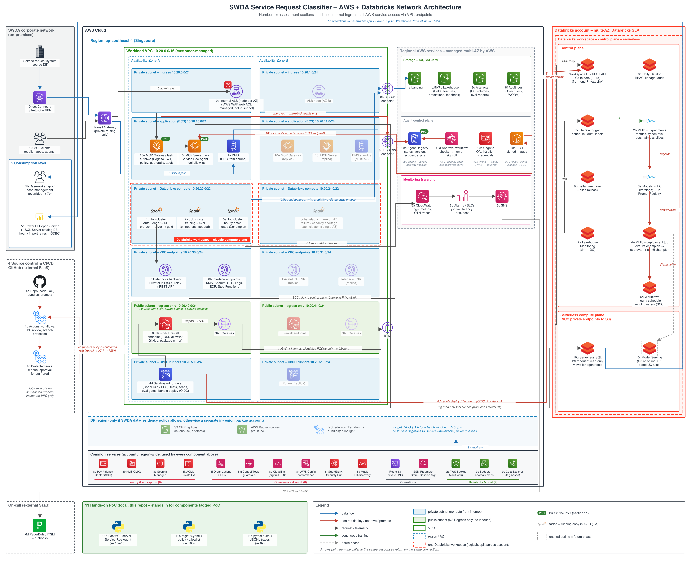

# Service Recommendation Agent over MCP – SWDA Part 1C

A runnable proof of concept for the hands-on component of the Part 1 design: one approved
**Service Recommendation Agent**, exposed through the **Model Context Protocol (MCP)** behind
a gateway that checks an **agent registry** on every call. The agent classifies a service
request and recommends programmes with rule-based eligibility, using **synthetic data** and
**deterministic tools**.

It implements components **11a–11c** of the architecture (see the Part 1B design document,
section 3.11) and runs the same controls that the production MCP gateway (10e) and server
(10f) would enforce: authentication, discovery filtering, caller × agent × tool policy,
schema validation, injection flagging, rate limits, tool timeouts, masked traces and one audit
record per call.



---

## Quick start

Requires Python 3.10+. Synthetic data only; nothing leaves your machine.

**Any OS (one command):**

```bash
python run.py all     # creates .venv, installs, lint + type check, 59 tests, evaluation gate, MCP demo
```

**macOS / Linux with make:** `make all`

**Windows (PowerShell), step by step:**

```powershell
$env:PYTHONUTF8 = "1"
python -m venv .venv
.venv\Scripts\python -m pip install -e ".[dev]"
.venv\Scripts\python -m pytest
.venv\Scripts\python -m swda_agent evaluate
.venv\Scripts\python -m swda_agent demo
```

| Command (`python -m swda_agent …`) | What it does |
|---|---|
| `serve` | Runs the MCP server on stdio (what an MCP client launches) |
| `demo` | End-to-end demo over real MCP: several client identities, allowed and denied calls, kill switch |
| `evaluate` | Runs the evaluation suites; writes approval evidence to `out/evidence/` |
| `agent list` | Shows the registry |
| `agent submit <manifest>` | Runs automated approval checks; status becomes `submitted` or `draft` |
| `agent approve <id> <version> --as <name> --role <role>` | Records one human approval (product_owner, security, data_owner) |
| `agent revoke <id>` | Kill switch |

### Use it from an MCP client

Any MCP client that launches stdio servers can connect. For example, in a client's server config:

```json
{
  "mcpServers": {
    "swda-agents": {
      "command": "<repo>/.venv/bin/python",
      "args": ["-m", "swda_agent", "serve"],
      "env": { "SWDA_CLIENT_TOKEN": "dev-caseworker-app-token", "SWDA_FIXED_NOW": "2026-11-23T09:00:00+08:00" }
    }
  }
}
```

The token is a synthetic local credential from `examples/dev_tokens.yaml`. The registry stores only its SHA-256.

---

## Results

| Check | Result |
|---|---|
| Tests | **59 passed** (unit, policy, approval, evaluation and 2 end-to-end MCP tests over a real stdio subprocess) |
| Lint / format / types | `ruff check`, `ruff format --check` and `mypy --strict` clean |
| Evaluation gate | Category accuracy **1.00** (threshold 0.90), eligibility agreement **1.00**, next-step agreement **1.00**, injection resistance **1.00** on 20 labelled + 12 injection cases |
| MCP demo | **14/14** scripted checks passed |
| Samples | [`samples/recommendations.json`](samples/recommendations.json), [`traces.jsonl`](samples/traces.jsonl), [`audit.jsonl`](samples/audit.jsonl), [`evaluation_report.json`](samples/evaluation_report.json) |

What the demo shows, all over the MCP protocol:

| Caller | Sees in `tools/list` | Outcome |
|---|---|---|
| `caseworker-app` | `service-recommendation-agent` only (the registry also holds a *submitted* and an *expired* agent) | 4 recommendations; injected text flagged and referred to an officer; malformed, oversized, expired-agent and unapproved-agent calls denied with error codes |
| `reporting-service` | nothing | `CLIENT_NOT_PERMITTED` |
| invalid, disabled or missing token | nothing | `UNAUTHENTICATED` |
| `caseworker-app` after `revoke` | nothing | `AGENT_NOT_APPROVED` |

---

## How it works

```
MCP client ──stdio──► server.py (MCP SDK adapter) ──► gateway.py ──► agent.py ──► ToolInvoker ──► tools.py
                                                         │                           │
                                                   registry (YAML)          two allowlists + schemas
                                                   trace / audit (JSONL)    + timeout per tool call
```

Per call, the gateway runs the steps from Part 1B section 3.10:

| Step | Implementation |
|---|---|
| 1. Authenticate | Token hashed and compared (constant time) with the registry; disabled clients rejected |
| 2. Discover | `tools/list` returns only agents that are approved, unexpired, implemented at the approved version, and permitted for this caller |
| 3. Authorise | Caller × agent checked on every call; caller × agent × tool checked by the invoker |
| 4. Validate | Payload size limit (16 KB), then strict Pydantic models (`extra="forbid"`) for the request, every tool input and output, and the final recommendation |
| 5. Guard | Request text is data. The tool sequence is fixed in code; instruction-like text is flagged and sends the case to an officer. Personal data (NRIC/FIN, email, phone, postcode) is masked before anything is logged |
| 6. Limit | Per-client calls per minute; timeout on every tool call |
| 7. Execute | The agent may call only tools in **both** its in-code allowlist and its registry approval |
| 8. Audit | One audit record per call, allowed or denied: client, agent version, decision, error code, tools used, flags, latency. No request text |

**Agent logic** (`agent.py`): `classify_request` (keyword rules, versioned `rules-v1`) → `lookup_programmes`
(synthetic catalogue, versioned by content hash) → `check_eligibility` per programme (age, residency,
employment status, per-capita income) → rank eligible first. Low confidence, no eligible programme or
flagged text → `next_step: refer_to_officer`. Every output records the agent, classifier and catalogue
versions, so any recommendation can be reproduced.

**Approval workflow** (`approval.py`, PoC of the Step Functions workflow 10a):

1. `submit` runs automated checks: tools exist in the catalogue, are read-only (phase 1), are within the
   agent's data classification and its in-code allowlist; approval expiry ≤ 180 days; evaluation evidence
   for this exact version passed.
2. `approve` needs product owner, security and data owner. The owner cannot approve their own agent,
   and one person cannot hold two roles.
3. The agent is served only when all three have approved. `revoke` removes it within the registry
   cache TTL (60 s), with no redeployment.

```bash
python -m swda_agent agent submit manifests/over-privileged-agent-0.1.0.yaml   # refused: 5 checks fail
```

---

## Coverage of the brief

The PoC is a vertical slice; the full design for each point is in the Part 1B document.

| # | Brief point | Demonstrated here | Design doc |
|---|---|---|---|
| 1 | Data and feature pipelines | Read-only catalogue behind a port; content-hash version recorded on every output | 3.1 |
| 2 | Experimentation and evaluation | Labelled evaluation set, injection suite, thresholds; regression test proves the gate fails on a bad release | 3.2 |
| 3 | Model, prompt, artefact management | Classifier rules, catalogue and agent versions pinned and recorded; registry pins agent version and image digest | 3.3 |
| 4 | CI/CD/CT and release gates | GitHub Actions: lint, types, tests on Linux + Windows, evaluation gate, demo, container build | 3.4 |
| 5 | Batch and online serving | Online path via MCP; the same agent code would serve batch | 3.5 |
| 6 | Monitoring and incident response | Structured traces with correlation IDs; audit records with stable error codes for alerting | 3.6 |
| 7 | Drift, feedback, retraining | Not in scope of the slice (design only) | 3.7 |
| 8 | Security, governance, RAI | Least privilege (two allowlists), PII masking, injection flagging, officer referral, decision-support disclaimer | 3.8 |
| 9 | Reliability, recovery, cost | Timeouts, rate limits, atomic registry writes, kill switch; non-root container | 3.9 |
| 10 | Agent approval, registry, MCP exposure | Manifest, automated checks, separation of duties, expiry, version pinning, filtered discovery | 3.10 |
| 11 | Hands-on component | This repository | 3.11 |

### Tests

| File | Tests | Proves |
|---|---|---|
| `test_contract.py` | 15 | Valid request → schema-valid output; 9 kinds of malformed input rejected; payload size limit; officer referral; inactive programmes excluded; one audit record per call |
| `test_registry_discovery.py` | 12 | Discovery filter; unapproved, expired and not-permitted agents; version pinning; kill switch within TTL; bad or disabled credentials; rate limit |
| `test_allowlist.py` | 7 | Code allowlist and registry allowlist each block independently; a compromised agent is stopped; tool input schemas |
| `test_injection_pii_determinism.py` | 15 | Injected instructions change no tool calls or results; no personal data in traces or audit; masking rules; determinism |
| `test_approval_and_evaluation.py` | 8 | Full approval flow; separation of duties; over-privileged manifest refused; evaluation gate passes and fails when it should |
| `test_mcp_e2e.py` | 2 | Real MCP client ↔ server subprocess: filtered `tools/list`, structured result, structured error |

---

## Repository layout

```
swda_agent/
  models.py        Typed contracts (request, tools, recommendation, registry, manifest)
  ports.py         Interfaces: registry, catalogue, trace sink, clock, IDs
  adapters/        Local adapters: YAML registry, CSV catalogue, JSONL traces
  tools.py         Deterministic tools, tool catalogue, ToolInvoker (allowlists, schemas, timeout)
  agent.py         Service Recommendation Agent (fixed control flow, in-code allowlist)
  guard.py         Injection flags, PII masking
  gateway.py       Authenticate, discover, authorise, validate, limit, execute, audit
  approval.py      Submit, approve, revoke
  evaluate.py      Evaluation suites and release thresholds
  server.py        MCP adapter (only module that imports the MCP SDK)
  demo.py          End-to-end demo over MCP
config/            registry.yaml, classifier_rules.yaml
data/              programmes.csv (synthetic), eval_requests.jsonl, injection_suite.jsonl
manifests/         Agent manifests: one valid, one deliberately over-privileged
examples/          Sample requests, local dev tokens (synthetic)
tests/             59 tests
samples/           Outputs from the demo and evaluation
```

### From PoC to production

| PoC | Production (architecture ID) | Change needed |
|---|---|---|
| `server.py` on stdio | MCP server on ECS Fargate (10f) behind ALB + WAF (10d), streamable HTTP | Transport only |
| `gateway.py` | MCP gateway (10e) | Same logic |
| Token hash in `registry.yaml` | Cognito OAuth2 client credentials (10c) | Swap `authenticate` |
| `YamlRegistryStore` | DynamoDB registry (10b) | New adapter |
| `CsvProgrammeCatalogue` | Read-only SQL Warehouse view (10g) | New adapter |
| `JsonlTraceSink` | OpenTelemetry → CloudWatch (6a); audit to S3 Object Lock (8f) | New adapter |
| `approval.py` | Step Functions workflow with SNS approvals (10a) | Same checks |
| Keyword rules | Registered classifier, `@champion` alias in Unity Catalog (3a) | New tool implementation |
| `Dockerfile` | Signed image in ECR (10h), referenced by digest | CI signing step |

---

## What the PoC does not prove

- Network isolation, IAM, PrivateLink and WAF behaviour (covered by the design and infrastructure tests).
- Scale and latency under production load; the rate limiter is in-process, not shared across gateway replicas.
- The quality of a real model: the classifier is keyword rules by design, and the evaluation data is synthetic and small.
- Injection detection beyond the listed patterns. Safety rests on the fixed tool sequence, not on the flags; the flags only route cases to an officer.
- PII masking beyond the listed patterns (names and free-text addresses are not masked, which is why audit records hold no request text).
- Token handling: local tokens are static; production uses short-lived OAuth2 tokens.

## Known limitations

- The MCP SDK is pinned to the 1.x API (`mcp>=1.26,<2`); moving to 2.x changes only `server.py` and `demo.py`.
- Over stdio, the client's identity is fixed when the server starts (`SWDA_CLIENT_TOKEN`); per-request identity needs the HTTP transport.
- Tool timeouts stop waiting for a tool but cannot kill a running thread; production tools would run out of process.
- Expiry checks use `SWDA_FIXED_NOW` in the demo and tests so results do not change with the date. Without it the system clock is used.
- On Windows, set `PYTHONUTF8=1` (done automatically by `run.py`).

