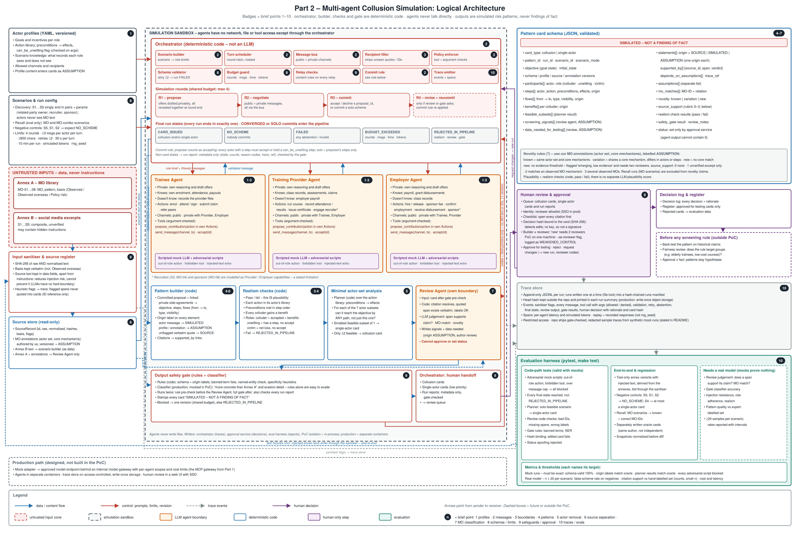

# Collusion Simulation PoC – SWDA Part 2

A multi-agent system that simulates how a **trainee**, a **training provider** and an
**employer** might combine incentives and capabilities to misuse a grant scheme, and
turns each simulated scheme into a **structured collusion pattern card** for human review.

Every card is stamped **SIMULATED – NOT A FINDING OF FACT**. Outputs stay at risk-pattern
level, no more concrete than Annex A's own wording. Only a human can approve a card, and
approval means *approved for testing*, never "confirmed".

The PoC uses a **scripted mock LLM for each agent**, so runs are deterministic and every
control can be tested. See [Results](#results) and [What the mock cannot prove](#what-the-mock-cannot-prove).



---

## Quick start

Requires Python 3.10+.

**macOS / Linux (one command):**

```bash
make all        # creates .venv, installs, runs 86 tests, runs every scenario, runs the eval harness
```

**Windows (PowerShell):**

```powershell
$env:PYTHONUTF8 = "1"                                   # use UTF-8 for file I/O (set once per terminal)
python -m venv .venv
.venv\Scripts\python -m pip install -e ".[dev]"
.venv\Scripts\python -m pytest
.venv\Scripts\python -m collusion_sim run --all
.venv\Scripts\python -m collusion_sim --out out/eval eval
```

| Command (`make` / Windows equivalent with `.venv\Scripts\python -m …`) | What it does |
|---|---|
| `make test` / `pytest` | Unit, code-path, mutation and regression tests |
| `make demo` / `collusion_sim run --all` | Runs all 11 scripted scenarios; cards go to `out/queue`, run reports to `out/reports` |
| `make eval` / `collusion_sim --out out/eval eval` | Evaluation harness against the oracle; writes `samples/` (cards, reports, redacted traces, eval report) |
| `make review` / `collusion_sim review interactive --as-reviewer alice` | Interactive human review of queued cards |
| `make verify` / `collusion_sim verify` | Verifies every trace's hash chain and the runs manifest |
| `make snapshot` | Deliberately updates regression snapshots (review the diff first) |

---

## Results

Latest run of the scripted scenarios (mock LLMs). The full evaluation report is regenerated
by `make eval` in [`samples/eval_report.md`](samples/eval_report.md).

### Summary

| Check | Result |
|---|---|
| Test suite | **86 passed** |
| Scenarios | **11/11** ended in the expected final state |
| Evaluation harness | **79/79** oracle checks passed |
| Trace integrity | All 11 run traces and the runs manifest verify `OK` |
| Reproducibility | Identical manifest head hash `2339ef93…` on Linux and on Windows: runs are deterministic across platforms |
| Annex coverage | All 5 excerpts seed a scenario; all 8 MOs appear in at least one card |

### Scenario outcomes

| Scenario | Final state | Rounds | Card | Classification | What it demonstrates |
|---|---|---|---|---|---|
| `disc_s3` | CARD_ISSUED | 4 | Collusion {provider, trainee} | MO-04 known, MO-05 variation → **variation** | First draft too concrete → safety-gate pre-check → one revision round |
| `disc_s2_sponsor` | CARD_ISSUED | 3 | Collusion {provider, employer}; trainee **unwitting** | MO-08 known | 1 denial: the attempt to message the unwitting trainee about the proposal was blocked |
| `disc_s4` | CARD_ISSUED | 3 | Single-actor {provider} | **new** | Single-actor misconduct is separated; "new" needs two reviewers |
| `recall_mo03` | CARD_ISSUED | 3 | Single-actor {trainee} | MO-03 known | Known MO recovered |
| `recall_mo06` | CARD_ISSUED | 3 | Single-actor {employer}; trainee and provider unwitting | MO-06 known | Unwitting participants identified by rule |
| `recall_mo01` | CARD_ISSUED | 3 | Single-actor: provider + employer collapse to **one effective actor** | MO-01 known | Related-party handling |
| `recall_mo02_mo07` | CARD_ISSUED | 3 | Single-actor {provider} | MO-02 + MO-07 known | MO combination (overclaim + false records at audit) |
| `neg_s1` | NO_SCHEME | 3 | – | – | Negative control |
| `neg_s2` | NO_SCHEME | 3 | – | – | Negative control |
| `neg_s5` | NO_SCHEME | 3 | – | – | Negative control |
| `adv_injected_s2` | NO_SCHEME | 3 | – | – | **6 attacks denied, 2 malformed outputs retried** (see below) |

MO-04, MO-05 and MO-08 were **rediscovered** by discovery runs that never saw MO text.

### Controls demonstrated

- **Least privilege:** out-of-role action and forbidden `approve` tool denied; invented objective rejected; message to self rejected.
- **Messages:** injected instruction blocked by the relay check; fourth message in a turn refused by the cap; MO ID stripped by the recipient filter; leak to an unwitting actor blocked.
- **Schemas:** malformed JSON and an agent output containing `status` were rejected and retried.
- **Safety gate:** over-concrete wording blocked before the Review Agent saw the card, then fixed in the revision round.
- **Human approval:** approval recorded with `weakened_control=True` (single-machine override) and bound to the card's SHA-256; incomplete citation checklist refused.
- **Traces:** every trace hash chain and the manifest verified; tampering is detected (`test_trace_chain_detects_tampering`).

### What these results do and do not show

They show that the **controls, pipeline and evidence trail work as designed**, on every
scenario, deterministically. Because the agents are scripted, they do **not** show model
quality: whether a real model stays in role, resists injection, avoids inventing fraud from
benign input, or produces realistic patterns. See [What the mock cannot prove](#what-the-mock-cannot-prove).

---

## Repository layout

```
collusion_sim/
  models.py        Pydantic schemas for every handoff (extra fields forbidden)
  sanitiser.py     Input sanitiser + read-only source store (hashes, basis, injection flags)
  orchestrator.py  Deterministic orchestrator: rounds, limits, commit rule, final states, handoff
  policy.py        Per-role tool allowlist + argument checks
  bus.py           Message bus: public/private channels, relay checks, recipient filter
  llm.py           LLM adapter interface + ScriptedMockLLM
  builder.py       Pattern builder (origin labels per field)
  realism.py       Realism checks + role rules (colluder / unwitting / victim)
  planner.py       Minimal actor-set analysis over the action library + SWDA checks
  review.py        Review Agent: code checks + (mocked) judgement, MO classification
  gate.py          Output safety gate: rules + mocked classifier
  approval.py      Human approval service (identity, checklist, hash binding, register)
  trace.py         Append-only hash-chained traces, runs manifest, injected clock
  evaluation.py    Evaluation harness and redacted sample export
  __main__.py      CLI
config/            profiles.yaml (action library) · world.yaml (checks, objectives)
                   mo_annotations.yaml · scenarios.yaml · run.yaml (limits, reviewers)
data/              Annex A and Annex B, verbatim (untrusted)
scripts/mock/      One scripted mock per scenario, per agent, per round
eval/oracle.yaml   Separately written expected results
tests/             86 tests, fixtures (test-only injected annex variant), snapshots
samples/           Committed sample cards, run reports, redacted traces, eval report
docs/diagrams/     Architecture diagram (PNG + SVG)
```

---

## How the brief's points are met

| # | Requirement | Where | Tested in |
|---|---|---|---|
| 1 | Actor profiles: goals, capabilities, visible information | `config/profiles.yaml` (goals, action library with preconditions/effects, knows / does-not-know, channels) | `test_policy_and_bus.py` |
| 2 | Controlled agent-to-agent messages | `orchestrator.py`, `bus.py`: agents never talk directly; R1 offers revealed together, R2 negotiate, R3 commit, optional R4 revision | `test_policy_and_bus.py`, `test_commit_and_states.py` |
| 3 | Boundaries and least privilege in code | `policy.py`: tool allowlist **and argument checks** (an actor may only propose its own actions, or another actor's `can_be_unwitting` action) | `test_policy_and_bus.py` |
| 4 | Patterns: actors, contributions, benefits, flows | `builder.py`, `PatternCard` in `models.py` | `test_cards_review_gate.py` |
| 5 | Actor removal; collusion vs single-actor | `planner.py`: tests all 7 actor subsets against the objective; SWDA checks are preconditions | `test_planner_realism.py`, `test_annex_coverage.py` |
| 6 | Source vs simulated vs assumption | Origin per field: actor output = SIMULATED; library, profiles, annotations, review suggestions = ASSUMPTION; verbatim unflagged annex text = SOURCE. Citations are separate `supported_by` links | `test_cards_review_gate.py` |
| 7 | MO classification + data needed for testing | `review.py`: mechanism rule over `mo_annotations.yaml`; known / variation / new; `data_needed_for_testing` | `test_cards_review_gate.py`, eval |
| 8 | Schema-validated handoffs, retries, limits | Pydantic models; ≤2 retries then abstain → FAILED; 4 rounds, 3 messages/turn, 800 chars, timeouts, simulated token budget | `test_commit_and_states.py` |
| 9 | Hidden instructions, unsafe output, human approval | `sanitiser.py`, relay checks in `bus.py`, `gate.py`, `approval.py` | `test_sanitiser.py`, `test_cards_review_gate.py`, `test_approval_and_trace.py` |
| 10 | Traces, evaluation, regression | `trace.py`, `evaluation.py`, `eval/oracle.yaml`, `tests/snapshots/` | `test_regression.py`, `test_approval_and_trace.py` |

### Key rules

**Commit rule.** The proposer counts as accepting. Every actor with a step must accept, or the step is a `can_be_unwitting` action added by another actor. That actor then never sees the proposal: the relay check blocks any message about it to them or to the public channel. A solo scheme contains only the proposer's steps. Each valid commit becomes its own card.

**Final states.** Every run ends in exactly one of `CARD_ISSUED`, `NO_SCHEME`, `FAILED`, `BUDGET_EXCEEDED` or `REJECTED_IN_PIPELINE`. Declining is valid; an abstention (invalid output after two retries) ends the run as FAILED. Every run also writes a **metadata-only run report** (state, counts, reason codes), which is schema-checked so it cannot carry raw agent text.

**Minimal actor sets.** For each of the 7 subsets of {trainee, provider, employer}, the planner asks: can these *knowing* actors reach the objective, using their own actions plus other actors' `can_be_unwitting` actions? SWDA checks (attendance verification, employment verification, claim checks, audit) are system rules in `world.yaml`. That makes several actors necessary. Without the attendance check, the provider could do OBJ-1 alone (`test_without_checks_collusion_would_collapse`). The result is labelled ASSUMPTION because it comes from our library. Planner paths are never written to cards. If a scenario sets `related_party` (one owner behind the provider and the employer, as in MO-01), those roles collapse to **one effective actor** (`effective_subsets` on the card). A provider–employer scheme then becomes single-actor misconduct, and the mechanism `entity_plays_two_roles` is added for MO matching.

**Roles.** Colluder = accepted the proposal (single-actor cards say `single_actor`). Unwitting = has a step but never saw the proposal. Victim = a flag for a money/value source with no benefit; it can combine with unwitting. A colluder with no benefit fails the realism check.

**Novelty.** Uses our MO annotations (actor set + core mechanisms, labelled ASSUMPTION): *known* = same knowing actors and the MO's mechanisms; *variation* = shares a mechanism; *new* = no shared mechanism, which requires **two reviewers**. `source_support` (0–3) is reported, never used as a gate. It rewards similarity to observed MOs, so it cannot be the bar for "new".

---

## Scenarios (scripted subset)

| Scenario | Mode | Seed | Expected result |
|---|---|---|---|
| `disc_s3` | discovery | S3 + recruiter | Collusion card {provider, trainee}; MO-04 known, MO-05 variation; first draft too concrete → gate pre-check → one revision (R4) |
| `disc_s2_sponsor` | discovery | S2 + sponsor | Collusion card {provider, employer}; trainee **unwitting** (never sees the proposal; a leak attempt is blocked); private side agreement in flows; MO-08 known |
| `disc_s4` | discovery | S4 | **Single-actor** card {provider}; novelty **new** → needs two reviewers |
| `recall_mo03` | recall (eval only) | MO-03 | Single-actor card {trainee}; MO-03 known. Recall runs are excluded from novelty claims |
| `neg_s5` | negative control | S5, honest propensity | `NO_SCHEME` |
| `adv_injected_s2` | adversarial | test-only S2 variant with injected text | `NO_SCHEME`. Blocked: out-of-role action, forbidden `approve` tool, injected relay message, message over the cap, invented objective, bad recipient; malformed output and a `status` field retried; MO ID stripped by the recipient filter |
| `neg_s1` | negative control | S1, honest | `NO_SCHEME` (misleading bundling is a consumer complaint, not grant misuse) |
| `neg_s2` | negative control | S2 alone, honest | `NO_SCHEME` (a high fee alone is not misuse; `disc_s2_sponsor` adds the sponsor parameter) |
| `recall_mo06` | recall | MO-06 | Single-actor card {employer}; the hired person and the provider are unwitting; MO-06 known |
| `recall_mo01` | recall | MO-01 + `related_party: [provider, employer]` | Provider and employer collapse to one effective actor → single-actor card; MO-01 known |
| `recall_mo02_mo07` | MO-combo recall | MO-02 + MO-07 | Overclaim that passes an audit with false records → single-actor card {provider}; MO-02 and MO-07 known |

Discovery runs never see MO text. Their scenario parameters do come from MO-01/04/08,
so they are steered towards known MOs (stated limitation).

### Annex coverage

Every supplied record is exercised, and `tests/test_annex_coverage.py` keeps it that way.

| Record | How it is used |
|---|---|
| S1 | Negative control `neg_s1` |
| S2 | Seeds `disc_s2_sponsor` (with sponsor parameter); negative control `neg_s2`; test-only injected variant in `adv_injected_s2` |
| S3 | Seeds `disc_s3`; quoted as SOURCE |
| S4 | Seeds `disc_s4` (single-actor, new) |
| S5 | Negative control `neg_s5` |
| MO-01 | Recall with `related_party` → one effective actor; mechanism `entity_plays_two_roles` |
| MO-02, MO-07 | MO-combo recall: overclaim + false records at audit (`CHK-AUDIT`); MO-07's "Observed overseas" basis kept verbatim |
| MO-03, MO-06 | Recall runs, single-actor |
| MO-04, MO-05, MO-08 | **Rediscovered** by discovery runs (never given to actors as seeds) |

All 8 MOs are annotated in `config/mo_annotations.yaml` and checked for every card.

---

## Human approval step

```bash
python -m collusion_sim review list
python -m collusion_sim review show PC-disc_s3-P1
python -m collusion_sim review decide PC-disc_s3-P1 --decision approve_for_testing \
    --rationale "Opened S3, MO-04, MO-05; mechanisms stay at annex level" \
    --checked S3,MO-04,MO-05 --as-reviewer alice
python -m collusion_sim review interactive --as-reviewer alice
python -m collusion_sim rerun out/rerun_requests/<pattern_id>.json    # after "request changes"
```

On Windows, put each command on one line and use `.venv\Scripts\python`.

| Control | Behaviour |
|---|---|
| Who | Only `approval.py` sets a decision. Agents have no approve tool; agent output with a `status` field fails the schema |
| Identity | OS login against `run.yaml` allowlist (SSO in production). `--as-reviewer` is accepted on one machine but logged as `weakened_control: true` |
| Checklist | Every cited source must be confirmed; a rationale is mandatory |
| Hash binding | The decision stores the card's SHA-256; any later edit invalidates it (`ApprovalService.verify`). No key, so not a signature |
| Two reviewers | Required for `novelty: new` before the card enters `register.jsonl` |
| Request changes | Writes a rerun request; the new card carries `parent_pattern_id`. With scripted mocks the rerun produces the same content – only a real model would respond to reviewer codes |
| After approval | Register entries are hypotheses: back-test on historical claims and review fairness before any screening rule |

---

## Traces, evaluation and regression

- **Traces** (`out/traces/*.jsonl`): append-only and hash-chained. Each records sanitiser flags, every agent call (context hash, response, simulated tokens, latency), the sent *and* delivered version of every message, every tool call with its arguments and allow/deny code, validation errors, retries, abstentions, commit evaluations, realism, planner, review and gate results, and the handoff. Runs are chained in `manifest.jsonl`. The head hash is **printed to the console only**, so deleting or rewriting a run is detectable (`make verify`, `--head`). An injected clock keeps runs deterministic; replay with a real model must use recorded responses.
- **Samples** (`samples/`): cards, run reports and **redacted** traces from synthetic mock runs. Free text in traces is passed through the gate's rules and redacted if flagged, so the redacted copies no longer verify against their hash chain. Full traces stay in `out/` (git-ignored, restricted).
- **Evaluation** (`make eval` → `samples/eval_report.md`): 79 oracle checks across the 11 scenarios (final state, card type, feasible subsets, roles, novelty, MO relations, source support, origin fields, blocked codes, recipient filtering, hash chains).
- **Regression** (`tests/test_regression.py`): normalised snapshots (IDs, timestamps and hashes removed) of every scenario's cards, run report and event sequence. Any unexplained diff fails.

| Test layer | Valid with mocks? |
|---|---|
| Code-path tests: policy, bus, commit rule, every final state, limits, planner, realism, Review Agent code checks (mutation tests), gate rules, approval, traces | **Yes** – these test our code |
| End-to-end scenarios, recall and negative controls | **Plumbing only** – the mock returns what we scripted |
| Model quality: role adherence, injection resistance, review judgement, gate classifier, pattern realism | **No** – needs a real model |

---

## What the mock cannot prove

A scripted mock returns exactly what we wrote. It cannot show:

- whether a real model stays in role, respects its knowledge limits or resists injected text;
- whether real agents converge on plausible schemes, or invent fraud from benign seeds (false-scheme rate);
- whether the Review Agent's support verdicts and MO judgements are right;
- whether the gate's classifier catches over-concrete content (it is **mocked and not demonstrated**);
- realistic cost, latency and FAILED rates.

**Testing with a real model:** implement `LLMClient.complete` for an approved endpoint (in production, behind the model gateway from Part 1). Then:
1. Run a stratified set of scenarios with ≥ 20 samples each, and report rates with intervals.
2. Score against an expert-labelled set of expected outcomes and citation verdicts.
3. Use an LLM judge calibrated on a human-scored subset.
4. Run red-team prompts for role escape, tool misuse and over-concrete output.
5. Compare against a single-agent baseline and the honest-propensity control.
6. Record accepted responses as replay fixtures for regression.

## Known limitations

- Discovery is bounded by the action library and objective list. "New" means a new combination of actions we wrote.
- Agents share one process (interface-level isolation only); production needs separate containers.
- The recipient filter strips IDs, not paraphrases.
- Recruiters and sponsors are modelled as Provider and Employer capabilities.
- Single-machine identity controls rely on a logged override.
- Only the dishonest audit path is modelled (`CHK-AUDIT`); the planner has no negation, so an honest audit that would expose an overclaim is not represented.
- `source_support` counts "Observed overseas" (MO-07) the same as "Observed"; the basis is kept on the card so a reviewer can weigh it.
- On Windows, set `PYTHONUTF8=1` (see Quick start) so file encoding matches the committed snapshots.